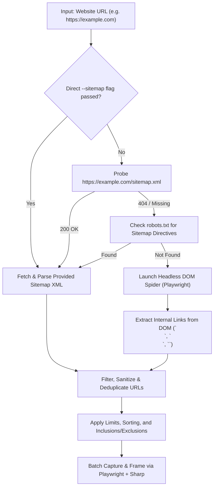

# Site-Wide Automated Page Capture Specification

> **Document Status:** Proposed Feature Specification  
> **Target Tool:** Hokusai CLI (`hokusai-ss` / `hokusai`)  
> **Related Components:** Playwright Engine, UrlProvider, Discovery Module

---

## 1. Executive Summary

This document specifies the design for enabling **automated multi-page website captures** in Hokusai. Instead of requiring users to manually pass multiple URLs via `-u <url>` or manually clicking through each page in the browser extension, Hokusai will introduce an automated discovery engine capable of:
1. Parsing XML Sitemaps (`sitemap.xml`) to extract all published routes.
2. Gracefully falling back to a headless Playwright DOM spider when a sitemap is unavailable.
3. Automatically generating framed portfolio screenshots (Desktop Arc, Mobile, and Full-page captures) for every discovered page.

---

## 2. Platform Comparison: CLI vs. Browser Extension

While multi-page automation was considered for the Hokusai browser extension, the **Hokusai CLI** is fundamentally better suited for site-wide batch captures:

| Evaluation Criteria | Browser Extension (MV3) | Hokusai CLI (`hokusai-ss`) |
| :--- | :--- | :--- |
| **Tab Handling** | Requires tab to be active/visible (`captureVisibleTab`); causes screen flashing | Headless Chromium instance; completely silent and backgrounded |
| **Lifecycle & Timeouts** | Background service workers terminate after idle; risky for long crawls | Node.js process; no artificial timeout constraints |
| **Framing Performance** | HTML5 Canvas in-browser; slower for high-res compositions | Native Sharp image processing with optimized WebP compression |
| **Output Pipeline** | Browser `downloads` API prompts user per file or requires zip bundling | Neatly outputs organized files directly into `./screenshots/` |
| **Primary Use Case** | Instant 1-click captures while browsing | Batch portfolio generation, automated audits, CI/CD builds |

---

## 3. Discovery Pipeline Architecture

When triggered with `--all-pages` or a sitemap target, Hokusai executes a tiered discovery chain:



---

## 4. Discovery Methods

### Level 1: Sitemap Parser (`sitemap.xml`)
When a sitemap is present, it provides the fastest and most accurate index of canonical pages.
- **Protocol Support:** Supports standard `<urlset>` containing `<url><loc>...</loc></url>` and nested `<sitemapindex>` indices.
- **Priority Extraction:** Reads `<priority>` and `<lastmod>` values to prioritize higher-weight pages.
- **Source Types:** Accepts live remote URLs (`https://example.com/sitemap.xml`) or local build artifacts (`./dist/sitemap.xml`).

### Level 2: In-Page DOM Spider (Fallback)
If a site lacks a `sitemap.xml` (e.g., small portfolios, staging sites, custom builds), Hokusai initiates a lightweight headless crawler:
1. Playwright navigates to the homepage and waits for network idle.
2. The crawler scans internal links:
   - **High-Priority Elements:** Links contained inside `<nav>`, `<header>`, and `<footer>` elements are processed first (e.g., `/about`, `/projects`, `/pricing`, `/contact`).
   - **Origin Matching:** Only URLs matching the same `window.location.origin` are collected.
   - **Sanitization Filters:**
     - Excludes hash fragments (`#section`), query strings (`?ref=...`), and external domains.
     - Excludes non-HTTP protocols (`mailto:`, `tel:`, `javascript:`).
     - Excludes common interactive / destructive routes (`/login`, `/logout`, `/cart`, `/checkout`).
3. Discovered URLs are normalized (trailing slashes stripped, lowercased).

### Level 3: Single-Page Site Handling
When all internal links point to hash anchors (`#about`, `#skills`) on the root page:
- Hokusai flags the site as a single-page application (SPA).
- Automatically executes full-page capture (`[slug]-full.webp`) or can scroll to each identified anchor to capture individual sections.

---

## 5. Safeguards for Large Websites

To protect against crawling unbounded sites (e.g., e-commerce catalogs or news archives with thousands of pages):

### 1. Safe Default Limits
- **Default Cap:** Defaults to a ceiling of **10 pages** if no limit is specified.
- **Override Flags:** Users can specify `-l, --limit <number>` or `--all` for exhaustive captures.

### 2. Smart Route Prioritization
Discovered URLs are sorted automatically before capture:
1. Root Homepage (`/`) is always first.
2. High sitemap `<priority>` entries (e.g., `1.0`, `0.8`).
3. Shallow URL path depth (e.g., depth 1 `/pricing`, `/about` before depth 3+ `/blog/2021/05/article`).

### 3. Route Pattern Filtering
Users can target or skip specific route trees:
```bash
# Capture only documentation pages
hokusai -u https://example.com --all-pages --include "/docs/*"

# Skip blog posts and tag directories
hokusai -u https://example.com --all-pages --exclude "*/blog/*" --exclude "*/tags/*"
```

### 4. Dry-Run Inspection
The `--dry-run` flag prints the list of discovered URLs with their resolved slugs and priorities without launching the browser or writing screenshots.

---

## 6. CLI Command Specifications

### Usage Examples

```bash
# 1. Automatic site capture (auto-detects sitemap, falls back to DOM spider)
hokusai -u https://example.com --all-pages

# 2. Direct sitemap capture with custom limit
hokusai --sitemap https://example.com/sitemap.xml --limit 15

# 3. Local build artifact sitemap
hokusai --sitemap ./dist/sitemap.xml

# 4. Preview matched pages without capturing
hokusai -u https://example.com --all-pages --dry-run

# 5. Filter specific paths
hokusai -u https://example.com --all-pages --include "/work/*" --limit 5
```

### Flag Reference

| Flag | Short | Type | Default | Description |
| :--- | :--- | :--- | :--- | :--- |
| `--all-pages` | | `boolean` | `false` | Automatically discover and capture all sub-pages for `--url`. |
| `--sitemap <path/url>` | `-s` | `string` | `null` | Path or URL to a sitemap XML file to extract targets from. |
| `--limit <number>` | `-l` | `number` | `10` | Maximum number of pages to capture. |
| `--all` | | `boolean` | `false` | Disable the default limit and capture all discovered pages. |
| `--depth <number>` | | `number` | `1` | Maximum link crawl depth when using the DOM spider. |
| `--include <pattern>` | | `string[]` | `[]` | Glob/path pattern of URLs to include. |
| `--exclude <pattern>` | | `string[]` | `[]` | Glob/path pattern of URLs to ignore. |
| `--dry-run` | | `boolean` | `false` | Discover and list target URLs without capturing. |

---

## 7. Output File Naming Convention

Captured images will generate consistent slugified filenames based on the route path:

| URL Target | Viewport | Generated Filename |
| :--- | :--- | :--- |
| `https://example.com/` | desktop (1440x900) | `screenshots/example-com-desktop.webp` |
| `https://example.com/` | mobile (390x844) | `screenshots/example-com-mobile.webp` |
| `https://example.com/about` | desktop (1440x900) | `screenshots/example-com-about-desktop.webp` |
| `https://example.com/pricing` | desktop (1440x900) | `screenshots/example-com-pricing-desktop.webp` |

---

## 8. Implementation Plan

1. **`src/utils/sitemap.js`:** Module to fetch, parse, and extract `<loc>` and `<priority>` from XML sitemaps.
2. **`src/engine/discover/spider.js`:** Playwright-based crawler module to discover internal same-origin links from rendered pages.
3. **`src/cli/index.js`:** Integrate `--all-pages`, `--sitemap`, `--limit`, `--include`, `--exclude`, and `--dry-run` flags into the CLI parser.
4. **`src/models/Site.js`:** Adapt slug generation to cleanly incorporate sub-route pathnames.
